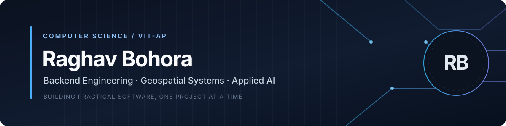

  

<h1 align="center">Hi, I'm Raghav Bohora 👋</h1>

  AI & machine learning student building end-to-end systems across computer vision, geospatial intelligence, and real-time software.

  
  

---

## About me

- 🎓 B.Tech in Computer Science and Engineering (AI & Machine Learning), VIT-AP University, 2023–2027
- 🧠 I build applied ML systems, from data pipelines and model training through evaluation and API integration
- 🛰️ Interested in computer vision, geospatial AI, model monitoring, and real-time anomaly detection
- 🧩 Core Technical Member, Machine Learning Club; I have led workshops and contributed to collaborative projects
- 🤝 Open to connecting with people building useful, well-engineered AI products

## Featured projects

### 🧠 [Brain MRI Scan Classification](https://github.com/RBohora/brain-mri-cnn-classifier)

An end-to-end medical imaging project for classifying brain MRI scans into multiple diagnostic categories. Built preprocessing and augmentation workflows, trained CNN and transfer-learning models, and added evaluation with precision, recall, ROC-AUC, and confidence outputs.

**Tech:** Python · PyTorch · TorchVision · OpenCV · scikit-learn

### 🌊 ResQTwin — AI-Driven Digital Twin for Emergency Response

An urban flood intelligence and emergency response platform combining satellite imagery, environmental signals, geospatial data, and risk analysis to support situational awareness and response planning. My work spans AI/ML architecture, model and data pipelines, explainability, and backend integration.

**Tech:** Python · PyTorch · FastAPI · React · JavaScript · GIS/geospatial tools

*Project repository coming soon.*

### 🎮 Photon Project

A project I’m preparing to publish. I’ll add its overview, technical details, and repository link here once it’s ready.

---

## Skills & tools

  
  
  
  
  
  
  
  
  
  
  

**ML:** CNNs, RNNs, transfer learning, statistical analysis, model evaluation, drift detection  
**Development:** REST APIs, FastAPI, JavaScript, HTML, Tailwind CSS  
**Databases & tools:** MySQL, MongoDB, Git, GitHub, VS Code

## Beyond code

As a Machine Learning Club core member, I have helped run hands-on workshops, campus hackathons, and technical events. I also volunteer as a community facilitator, supporting constructive dialogue and community awareness.

## Find me

- GitHub: [@RBohora](https://github.com/RBohora)
- Browse my [repositories](https://github.com/RBohora?tab=repositories)

---

  <i>Building practical AI systems with curiosity and care.</i>

